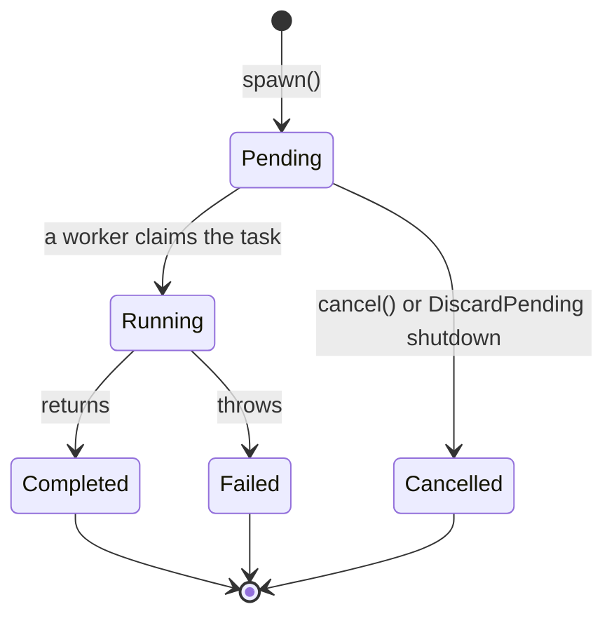
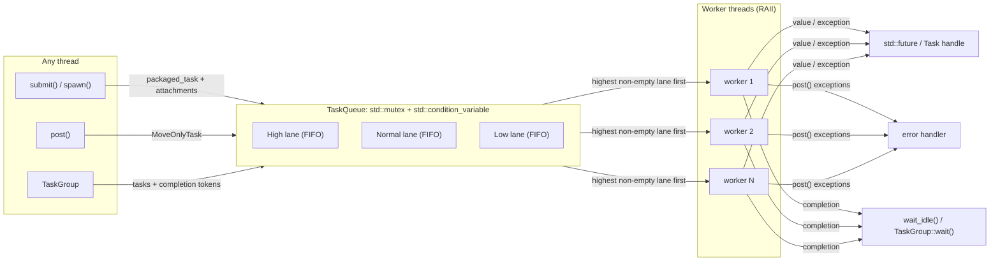

# header-only-task-pool

[](https://en.cppreference.com/w/cpp/17)
[](#quick-start)
[](#quick-start)
[](LICENSE)

A **header-only, zero-dependency, modern C++17 thread pool** with first-class
`std::future` support, priority scheduling, cancellable tasks with an
observable lifecycle, and graceful shutdown. Copy one folder into your project,
`#include` one header, and start running work in parallel: no build step, no
third-party libraries, no leaks.

```cpp
#include <taskpool/TaskPool.hpp>

taskpool::TaskPool pool;                              // one worker per hardware thread
auto answer = pool.submit([](int a, int b) { return a * b; }, 6, 7);
std::cout << answer.get();                            // 42
```

> 🇹🇷 Türkçe dokümantasyon için [aşağıya kaydırın](#-türkçe).

---

## Contents

- [Features](#features)
- [Quick start](#quick-start)
- [Usage](#usage)
  - [Futures](#returning-values-with-stdfuture) · [Callables & arguments](#functions-functors-and-member-functions) · [Move-only types](#move-only-types) · [Exceptions](#exceptions)
  - [Priorities](#priorities) · [Task groups](#task-groups-raii) · [Task lifecycle & cancellation](#task-lifecycle--cancellation)
  - [Error handler](#error-handler-for-fire-and-forget-tasks) · [Timed waits](#timed-waits) · [Shutdown](#graceful-shutdown)
- [Architecture](#architecture)
- [API reference](#api-reference)
- [Guarantees](#guarantees)
- [Performance](#performance)
- [Building tests, examples and benchmarks](#building-tests-examples-and-benchmarks)
- [Contributing](#contributing)
- [Türkçe](#-türkçe)

## Features

- **Header-only & zero dependencies:** only the C++17 standard library.
- **RAII lifecycle:** workers start in the constructor; the destructor finishes
  every pending task and joins all threads.
- **`submit()` returns `std::future<T>`:** built on `std::packaged_task`, with
  the return type deduced for you (`std::future<void>` included).
- **Priority lanes:** `High`, `Normal` and `Low`, FIFO within each lane.
- **`TaskGroup`:** an RAII scope that waits for *its own* tasks only
  (structured concurrency).
- **`Task<T>` handles:** observe `Pending → Running → Completed / Failed` and
  cancel tasks that have not started yet.
- **Graceful shutdown:** `Drain` the backlog or `DiscardPending` work, safely
  and idempotently.
- **Error handler:** exceptions from fire-and-forget tasks are reported
  instead of silently swallowed.
- **Move-only friendly:** callables and arguments are *moved* end-to-end, so
  `std::unique_ptr` captures just work.
- **CMake package:** `add_subdirectory`, `FetchContent` or `find_package`.

## Quick start

### Option 1: copy the headers

Copy the `include/taskpool/` folder into your project and compile with C++17:

```bash
g++ -std=c++17 -O2 -pthread -Ipath/to/include main.cpp
```

### Option 2: CMake `FetchContent`

```cmake
include(FetchContent)
FetchContent_Declare(
    taskpool
    GIT_REPOSITORY https://github.com/erencicekk25/header-only-task-pool.git
    GIT_TAG        main)
FetchContent_MakeAvailable(taskpool)

target_link_libraries(my_app PRIVATE taskpool::taskpool)
```

When consumed as a sub-project, the tests, examples and benchmarks are **not**
built, so the library adds nothing to your build time.

### Option 3: install and `find_package`

```bash
cmake -S . -B build -DCMAKE_BUILD_TYPE=Release
cmake --install build --prefix /your/prefix
```

```cmake
find_package(taskpool CONFIG REQUIRED)
target_link_libraries(my_app PRIVATE taskpool::taskpool)
```

## Usage

### Returning values with `std::future`

```cpp
taskpool::TaskPool pool(4);                           // exactly 4 workers

std::future<std::string> greeting = pool.submit([] { return std::string("hello"); });
std::future<void>        done     = pool.submit([] { /* side effects */ });

std::cout << greeting.get() << '\n';
done.get();
```

### Functions, functors and member functions

```cpp
int add(int a, int b) { return a + b; }

struct Account {
    int balance = 100;
    int deposit(int amount) { return balance += amount; }
};

Account account;
auto f1 = pool.submit(add, 40, 2);                          // free function
auto f2 = pool.submit(&Account::deposit, &account, 50);     // member function
auto f3 = pool.submit([](const std::vector<int>& v) { return v.size(); },
                      std::vector<int>{1, 2, 3});           // argument moved in
```

Arguments are copied or moved into the task, exactly like `std::thread`. Use
`std::ref` / `std::cref` when you really want to share a reference:

```cpp
int counter = 0;
pool.submit([](int& c) { ++c; }, std::ref(counter)).get();
```

### Move-only types

```cpp
auto buffer = std::make_unique<std::vector<float>>(1'000'000, 1.0f);

auto sum = pool.submit([](std::unique_ptr<std::vector<float>> data) {
    return std::accumulate(data->begin(), data->end(), 0.0f);
}, std::move(buffer));

auto handle = pool.submit([] { return std::make_unique<Widget>(); });  // move-only result
```

### Exceptions

```cpp
auto risky = pool.submit([]() -> int { throw std::runtime_error("oops"); });
try {
    risky.get();
} catch (const std::runtime_error& e) {
    std::cerr << "task failed: " << e.what() << '\n';   // the pool keeps running
}
```

### Priorities

Every entry point has a `*_with_priority` variant. Workers always take the next
task from the highest non-empty lane; tasks of equal priority run in FIFO order.

```cpp
using taskpool::Priority;

pool.post_with_priority(Priority::Low,  rebuild_search_index);
pool.post(resize_thumbnail);                                   // Priority::Normal
auto reply = pool.submit_with_priority(Priority::High, handle_request, request);

pool.pending_tasks(Priority::High);                            // per-lane backlog
```

> Priorities are strict: a never-ending stream of `High` tasks can starve `Low`
> ones. Reserve `High` for short, latency-sensitive work.

### Task groups (RAII)

`TaskGroup` (in `<taskpool/TaskGroup.hpp>`) tracks a batch of tasks. `wait()`
and the destructor wait for **that batch only**, not for unrelated work in the
same pool.

```cpp
#include <taskpool/TaskGroup.hpp>

{
    taskpool::TaskGroup group(pool, taskpool::Priority::High);
    for (auto& image : images)
        group.post(apply_filter, std::ref(image));

    auto stats = group.submit(collect_stats, std::cref(images));   // futures work too

    if (!group.wait_for(100ms))          // timed variant, false on timeout
        show_progress(group.unfinished_tasks());
}   // ~TaskGroup: every image is processed here
```

### Task lifecycle & cancellation

`spawn()` returns a `Task<T>` handle that exposes the task's state and can
cancel it while it is still queued. Running tasks are never interrupted.

```cpp
taskpool::Task<Report> task = pool.spawn(build_report, period);

task.state();                // TaskState::Pending / Running / Completed / Failed / Cancelled
taskpool::to_string(task.state());  // "Pending", ...

if (user_pressed_cancel && task.cancel()) {
    // Never runs. get() throws taskpool::TaskCancelled immediately.
}

task.wait_for(50ms);         // std::future_status, like std::future
Report report = task.get();  // result, the task's exception, or TaskCancelled
```



Transitions are lock-free compare-and-swap operations, so a task can never both
run and be cancelled. The final state is published *before* the result becomes
ready: once `get()` returns or throws, `state()` is terminal.

### Error handler for fire-and-forget tasks

`submit()` and `spawn()` deliver exceptions through their futures. Exceptions
escaping `post()` tasks go to an optional handler, called on the worker thread:

```cpp
pool.set_error_handler([](std::exception_ptr error) {
    try { std::rethrow_exception(error); }
    catch (const std::exception& e) { log_error("background task failed: ", e.what()); }
});
pool.set_error_handler({});  // remove it again
```

The handler can be replaced at any time from any thread. If the handler itself
throws, that exception is contained and the worker keeps running.

### Timed waits

```cpp
pool.wait_idle();                       // block until queue empty and nothing running
if (!pool.wait_idle_for(2s))            // watchdog / health check
    alert("pool still has", pool.unfinished_tasks(), "tasks");
```

### Graceful shutdown

The destructor drains the pool for you. Call `shutdown()` to stop it explicitly:

```cpp
pool.shutdown();                                     // ShutdownPolicy::Drain (default)
pool.shutdown(taskpool::ShutdownPolicy::DiscardPending);
```

| Policy | Queued tasks | Running tasks | New work |
| --- | --- | --- | --- |
| `Drain` | run to completion, including nested ones | finish | rejected after the drain |
| `DiscardPending` | destroyed without running | finish | rejected immediately |

- Discarded `submit()` futures throw `std::future_error` (`broken_promise`);
  discarded `spawn()` handles report `TaskState::Cancelled`.
- Enqueuing after shutdown throws `taskpool::PoolStoppedError`.
- `shutdown()` is idempotent and safe to call from several threads. Calling it
  from one of the pool's own workers throws `std::logic_error` instead of
  deadlocking.

Runnable versions of all of the above live in [`examples/`](examples).

## Architecture



**Building blocks**

| Header | Responsibility |
| --- | --- |
| `taskpool/TaskPool.hpp` | Pool, scheduling API, shutdown, error handler |
| `taskpool/TaskQueue.hpp` | Closable, thread-safe queue with one FIFO lane per priority |
| `taskpool/Task.hpp` | `Task<T>`, `TaskState`, `TaskCancelled` and the lifecycle state machine |
| `taskpool/TaskGroup.hpp` | RAII task groups |
| `taskpool/Priority.hpp` | `Priority` enum |
| `taskpool/detail/MoveOnlyTask.hpp` | Type-erased, move-only `void()` callable |

**Design notes**

- Each queued task is a single `MoveOnlyTask`; nothing is copied on the way to
  a worker.
- Bookkeeping objects (group completion tokens, lifecycle owners) travel *next
  to* the `std::packaged_task`, not inside it. A packaged task's callable lives
  as long as its future, so putting them inside would tie completion to the
  caller releasing the future.
- The queue only signals its condition variable when a worker is actually
  sleeping, which avoids needless system calls under load.

## API reference

All symbols live in namespace `taskpool`. `F` is any callable and `R` is
`std::invoke_result_t<F, Args...>`.

### `TaskPool`

| Member | Description |
| --- | --- |
| `explicit TaskPool(std::size_t threads = 0)` | Starts `threads` workers; `0` means `default_thread_count()`. |
| `~TaskPool()` | `shutdown(ShutdownPolicy::Drain)`; a no-op if already shut down. |
| `std::future<R> submit(F&&, Args&&...)` | Schedules a task and returns its future. `[[nodiscard]]`. |
| `std::future<R> submit_with_priority(Priority, F&&, Args&&...)` | Same, in a specific lane. |
| `Task<R> spawn(F&&, Args&&...)` | Schedules a task and returns a lifecycle handle. `[[nodiscard]]`. |
| `Task<R> spawn_with_priority(Priority, F&&, Args&&...)` | Same, in a specific lane. |
| `void post(F&&, Args&&...)` | Fire-and-forget; exceptions go to the error handler. |
| `void post_with_priority(Priority, F&&, Args&&...)` | Same, in a specific lane. |
| `void wait_idle()` | Blocks until nothing is queued or running. |
| `bool wait_idle_for(duration)` | Same, with a timeout; `false` on timeout. |
| `void shutdown(ShutdownPolicy = Drain)` | Stops the pool and joins the workers (see above). |
| `bool is_running() const noexcept` | `false` once `shutdown()` has started. |
| `bool is_worker_thread() const noexcept` | `true` on one of this pool's workers. |
| `void set_error_handler(std::function<void(std::exception_ptr)>)` | Handler for exceptions escaping `post()` tasks. |
| `std::size_t thread_count() const noexcept` | Number of worker threads. |
| `std::size_t pending_tasks() const` / `pending_tasks(Priority)` | Queued tasks, in total or per lane. |
| `std::size_t unfinished_tasks() const noexcept` | Queued **or** running tasks. |
| `static std::size_t default_thread_count() noexcept` | `hardware_concurrency()`, or `1` if unknown. |

`TaskPool` is neither copyable nor movable: workers refer to the pool, so it
stays at a fixed address. Wrap it in `std::unique_ptr` to transfer ownership.

### `Task<T>`

| Member | Description |
| --- | --- |
| `TaskState state() const` | Current lifecycle state. |
| `bool cancel()` | `Pending → Cancelled`; `false` if already running or finished. |
| `T get()` | Result, the task's exception, or `TaskCancelled`. |
| `void wait() const` / `wait_for(d)` / `wait_until(t)` | Like `std::future`; cancelled tasks are ready immediately. |
| `bool ready() const` | `true` if `get()` would not block. |
| `bool valid() const noexcept` | `true` until the result has been retrieved. |

Free functions: `to_string(TaskState)`, `is_terminal(TaskState)`.

### `TaskGroup`

| Member | Description |
| --- | --- |
| `TaskGroup(TaskPool&, Priority = Normal)` | Creates a group bound to a pool and lane. |
| `~TaskGroup()` | Waits for the group's tasks. |
| `submit(F&&, Args&&...)` / `post(F&&, Args&&...)` | Like the pool's, but tracked by the group. |
| `void wait()` / `bool wait_for(duration)` | Waits for the group's tasks only. |
| `std::size_t unfinished_tasks() const` | Group tasks that are queued or running. |

### Other types

| Type | Description |
| --- | --- |
| `enum class Priority { Low, Normal, High }` | Scheduling lanes. |
| `enum class TaskState { Pending, Running, Completed, Failed, Cancelled }` | Lifecycle states. |
| `enum class ShutdownPolicy { Drain, DiscardPending }` | Shutdown behaviour. |
| `class PoolStoppedError : std::runtime_error` | Enqueue after shutdown. |
| `class TaskCancelled : std::runtime_error` | `get()` on a cancelled task. |
| `template <class T> class TaskQueue` | The thread-safe priority queue; usable on its own. |

## Guarantees

- **Thread safety:** every public member may be called concurrently from any
  thread, including from inside tasks (except the waits noted below).
- **No lost work:** `Drain` and the destructor finish every queued task,
  including tasks enqueued by other tasks.
- **No lost wake-ups:** predicates are checked under the mutex, and completion
  notifications take the lock before signalling.
- **Zero leaks:** ownership is expressed with `std::unique_ptr`,
  `std::shared_ptr`, `std::packaged_task` and `std::future` only; there is no
  raw `new` / `delete`.
- **Deterministic resource release:** for `post()` and `TaskGroup` tasks,
  everything a task captured is destroyed *before* its completion is reported,
  so after `wait_idle()` / `group.wait()` those resources are gone. For
  `submit()` / `spawn()`, the standard library keeps the callable alive until
  the matching future (or `Task<T>`) is released or `get()` is called.
- **Exception-safe construction:** if starting a thread fails, the threads
  that did start are joined before the exception propagates.

**Caveats**

- Do not call `wait_idle()` or `TaskGroup::wait()` from inside a task that the
  wait would include: the task would wait for itself.
- Blocking on `future.get()` inside a task is only safe if other workers can
  make progress; on a saturated pool it can deadlock (as with any fixed-size
  pool). Prefer returning futures to the caller.

## Performance

Sample results from the bundled benchmark (`taskpool_benchmark`), v1.1.0,
Release build, MinGW-w64 GCC 16.2, Windows 11, 14 hardware threads, median of
5 runs. Run-to-run noise on this laptop is noticeable (±30 % on the
single-threaded baselines), so run it on your own hardware.

**Dispatch overhead:** 200,000 trivial tasks (per-task cost):

| Strategy | ns / task | Relative |
| --- | ---: | ---: |
| `std::thread` per task | 68,387 | 1.0x |
| `std::async(std::launch::async)` | 71,854 | 1.0x |
| `TaskPool::submit` (with `std::future`) | 3,457 | **19.8x** |
| `TaskPool::post` | 10,720 | 6.4x |

**CPU-bound:** counting primes below 3,000,000 in 300 chunks:

| Strategy | Time (ms) | Speed-up |
| --- | ---: | ---: |
| Single thread | 590.6 | 1.0x |
| `std::async` per chunk | 55.5 | 10.6x |
| `TaskPool::submit` per chunk | 52.6 | **11.2x** |

**Medium tasks:** 4,000 floating-point jobs:

| Strategy | Time (ms) | Speed-up |
| --- | ---: | ---: |
| Single thread | 459.6 | 1.0x |
| `std::async` per task | 223.8 | 2.1x |
| `TaskPool::submit` per task | 57.2 | **8.0x** |

**How to read these numbers**

- Reusing threads is the big win: thread creation dominates whenever tasks are
  short, which is where `std::async` and raw `std::thread` fall behind.
- The pool uses a **single shared queue** guarded by one mutex. For *trivially*
  small tasks, all workers compete for that lock, so per-task cost grows with
  the thread count. On the same machine `post` costs about 350 ns per task
  with 2 workers. In the table above, the `post` tasks also all write to one
  shared atomic counter.
- **Rule of thumb:** give each task at least a few microseconds of work. Batch
  tiny items into chunks (as in the prime-counting scenario) and the pool
  scales close to linearly.

## Building tests, examples and benchmarks

```bash
cmake -S . -B build -DCMAKE_BUILD_TYPE=Release
cmake --build build --config Release
ctest --test-dir build -C Release --output-on-failure

./build/examples/basic_usage
./build/examples/priorities_and_groups
./build/examples/lifecycle_and_shutdown
./build/benchmarks/taskpool_benchmark        # optional arg: thread count
```

> If your path contains non-ASCII characters (e.g. `Kişisel Projeler`), use the
> Ninja generator (`-G Ninja`); MinGW Makefiles cannot handle such paths.

| CMake option | Default (top-level) | Purpose |
| --- | --- | --- |
| `TASKPOOL_BUILD_TESTS` | `ON` | Unit tests (built-in micro test harness, no dependencies). |
| `TASKPOOL_BUILD_EXAMPLES` | `ON` | The programs in `examples/`. |
| `TASKPOOL_BUILD_BENCHMARKS` | `ON` | `benchmarks/taskpool_benchmark`. |
| `TASKPOOL_ENABLE_SANITIZERS` | `OFF` | AddressSanitizer + UBSan (GCC/Clang). |
| `TASKPOOL_ENABLE_TSAN` | `OFF` | ThreadSanitizer (GCC/Clang). |

The CI workflow builds and tests the project with GCC, Clang, AppleClang and
MSVC, and runs the suite under AddressSanitizer and ThreadSanitizer.

### Project layout

```
include/taskpool/
├── TaskPool.hpp              # the pool: submit(), spawn(), post(), shutdown()
├── TaskQueue.hpp             # thread-safe, closable priority queue
├── Task.hpp                  # Task<T> handle + lifecycle state machine
├── TaskGroup.hpp             # RAII task groups
├── Priority.hpp              # Priority enum
└── detail/MoveOnlyTask.hpp   # type-erased move-only void() callable
examples/                     # runnable, commented examples
benchmarks/benchmark.cpp      # dispatch, CPU-bound and medium-task benchmarks
tests/                        # unit tests + tiny dependency-free harness
cmake/                        # package config for find_package()
```

## Contributing

Contributions are very welcome! Read [CONTRIBUTING.md](CONTRIBUTING.md) and look
for issues labelled
[`good first issue`](https://github.com/erencicekk25/header-only-task-pool/labels/good%20first%20issue).

## License

[MIT](LICENSE): free for commercial and open-source use.

---

## 🇹🇷 Türkçe

**header-only-task-pool**, modern C++17 ile yazılmış, **yalnızca başlık
dosyalarından oluşan (header-only)** ve **hiçbir dış bağımlılığı olmayan** bir
thread pool (iş parçacığı havuzu) kütüphanesidir. `include/taskpool/`
klasörünü projenize kopyalayıp `#include` etmeniz yeterli. Ayrıca derlemeniz
gereken bir şey yok, üçüncü parti kütüphane kurmanız gerekmiyor.

### Neler sunuyor?

- **Sıfır bağımlılık:** Sadece C++17 standart kütüphanesi.
- **RAII ile otomatik yönetim:** Worker thread'ler constructor'da başlar.
  Destructor bekleyen tüm işleri bitirip thread'leri güvenle `join` eder.
- **`std::future` desteği:** `submit()`, dönüş tipini kendisi çıkaran bir
  `std::future<T>` döndürür.
- **Öncelik şeritleri:** `High`, `Normal`, `Low`. Aynı öncelikteki görevler
  geliş sırasıyla (FIFO) çalışır.
- **`TaskGroup`:** Sadece *kendi* görevlerini bekleyen RAII kapsamı.
- **`Task<T>` tutamaçları:** Görevin durumunu izleyin, başlamamış görevleri
  iptal edin.
- **Güvenli kapanış:** Kuyruğu bitirerek (`Drain`) ya da bekleyenleri atarak
  (`DiscardPending`) kapatma.
- **Hata yakalayıcı:** `post()` görevlerinden kaçan istisnalar artık sessizce
  kaybolmaz.
- **Move semantiği:** Görevler ve argümanlar baştan sona *taşınır*, hiç
  kopyalanmaz. `std::unique_ptr` gibi yalnızca taşınabilir tipler sorunsuz
  çalışır.

### Kurulum

```bash
g++ -std=c++17 -O2 -pthread -Iinclude main.cpp
```

CMake kullanıyorsanız `FetchContent` ile ekleyip
`target_link_libraries(uygulamam PRIVATE taskpool::taskpool)` satırını
yazmanız yeterli (ayrıntılar için yukarıdaki *Quick start* bölümüne bakın).

### Temel kullanım

```cpp
#include <taskpool/TaskPool.hpp>
#include <iostream>

int topla(int a, int b) { return a + b; }

int main() {
    taskpool::TaskPool havuz;                       // donanım thread sayısı kadar worker

    auto sonuc  = havuz.submit(topla, 40, 2);       // std::future<int>
    auto mesaj  = havuz.submit([] { return std::string("merhaba"); });
    auto hatali = havuz.submit([]() -> int { throw std::runtime_error("hata!"); });

    std::cout << sonuc.get() << ' ' << mesaj.get() << '\n';   // 42 merhaba

    try {
        hatali.get();
    } catch (const std::exception& e) {
        std::cout << "Yakalandı: " << e.what() << '\n';
    }

    havuz.post([] { /* sonucu beklenmeyen arka plan işi */ });
    havuz.wait_idle();                              // tüm işler bitene kadar bekle
}   // havuz burada kalan işleri tamamlar ve thread'leri güvenle kapatır
```

### Öncelikler

Her fonksiyonun bir `*_with_priority` sürümü vardır. Worker'lar her zaman en
yüksek öncelikli dolu şeritten görev alır.

```cpp
using taskpool::Priority;

havuz.post_with_priority(Priority::Low, arama_indeksini_yenile);
havuz.post(kucuk_resim_olustur);                          // Priority::Normal
auto yanit = havuz.submit_with_priority(Priority::High, istegi_isle, istek);
```

> Öncelikler katıdır: Sürekli `High` görev gelirse `Low` görevler hiç sıra
> bulamayabilir. `High`'ı kısa ve gecikmeye duyarlı işler için kullanın.

### Görev grupları (`TaskGroup`)

`TaskGroup`, bir grup görevi takip eder. `wait()` ve destructor yalnızca **bu
grubun** görevlerini bekler; havuzdaki başka işleri beklemez.

```cpp
#include <taskpool/TaskGroup.hpp>

{
    taskpool::TaskGroup grup(havuz);
    for (auto& resim : resimler)
        grup.post(filtre_uygula, std::ref(resim));
}   // ~TaskGroup: tüm resimler burada işlenmiş olur
```

### Görev yaşam döngüsü ve iptal

`spawn()`, görevin durumunu gösteren ve henüz başlamamışsa iptal etmeye
yarayan bir `Task<T>` döndürür. Çalışmakta olan görevler asla yarıda kesilmez.

```cpp
auto gorev = havuz.spawn(rapor_olustur, donem);

gorev.state();     // Pending, Running, Completed, Failed veya Cancelled
if (gorev.cancel()) {
    // Görev hiç çalışmayacak; get() hemen taskpool::TaskCancelled fırlatır.
}
```

Durum geçişleri kilitsiz (lock-free) compare-and-swap ile yapılır. Bu yüzden
bir görev aynı anda hem çalışıp hem iptal edilemez.

### Hata yakalayıcı ve zaman aşımlı bekleme

```cpp
havuz.set_error_handler([](std::exception_ptr hata) {
    try { std::rethrow_exception(hata); }
    catch (const std::exception& e) { std::cerr << "Arka plan hatası: " << e.what() << '\n'; }
});

if (!havuz.wait_idle_for(std::chrono::seconds(2)))
    std::cerr << "Havuz hâlâ meşgul!\n";
```

### Güvenli kapanış

```cpp
havuz.shutdown();                                         // Drain: kuyruktaki her şeyi bitir
havuz.shutdown(taskpool::ShutdownPolicy::DiscardPending); // bekleyenleri at, çalışanları bitir
```

- `DiscardPending` ile atılan `submit()` görevlerinin future'ları
  `std::future_error` (`broken_promise`) fırlatır. Atılan `spawn()` görevleri
  `Cancelled` durumuna geçer.
- Kapanıştan sonra görev eklemek `taskpool::PoolStoppedError` fırlatır.
- `shutdown()` birden fazla kez veya aynı anda birden fazla thread'den
  çağrılabilir. Havuzun kendi worker'ından çağrılırsa kilitlenmek yerine
  `std::logic_error` fırlatır.

### Mimari

Yukarıdaki [Architecture](#architecture) bölümündeki diyagram akışı özetler.
Görevler herhangi bir thread'den eklenir ve öncelik şeritlerine sahip, mutex
korumalı tek bir kuyruğa girer. Worker'lar en yüksek öncelikli şeritten görev
alır. Sonuçlar `std::future` / `Task<T>` üzerinden, `post()` hataları ise hata
yakalayıcı üzerinden döner.

### Performans notları

Benchmark sonuçları (yukarıdaki *Performance* bölümü), thread'leri yeniden
kullanmanın her görev için yeni `std::thread` ya da `std::async` açmaktan
**yaklaşık 20 kat daha hızlı** olabildiğini gösteriyor. CPU yoğun işlerde ise
14 thread'li bir makinede **11 katı aşan** bir hızlanma elde edildi.

Kütüphane, tek bir mutex ile korunan **ortak bir kuyruk** kullanır. Çok küçük
(nanosaniyeler süren) görevlerde tüm worker'lar aynı kilit için yarışır. Bu
yüzden en iyi sonuç için **her görevin en az birkaç mikrosaniyelik iş
yapmasını** sağlayın ve küçük işleri parçalar (chunk) halinde gruplayın.

### Dikkat edilmesi gerekenler

- Bir görevin içinden, o görevi de kapsayan bir `wait_idle()` veya
  `TaskGroup::wait()` çağırmayın; görev kendini bekler ve kilitlenir.
- Dolu bir havuzda bir görevin başka bir görevin `future.get()` sonucunu
  beklemesi kilitlenmeye (deadlock) yol açabilir. Bunun yerine future'ları
  çağıran tarafa döndürün.

### Derleme ve test

```bash
cmake -S . -B build -G Ninja -DCMAKE_BUILD_TYPE=Release
cmake --build build
ctest --test-dir build --output-on-failure
./build/examples/priorities_and_groups
./build/examples/lifecycle_and_shutdown
```

> Yol (path) içinde Türkçe karakter varsa (`Kişisel Projeler` gibi) Ninja
> generator'ını kullanın; MinGW Makefiles bu tür yollarla çalışamıyor.

### Katkıda bulunun

Katkılarınızı bekliyoruz! [CONTRIBUTING.md](CONTRIBUTING.md) dosyasını okuyun ve
[`good first issue`](https://github.com/erencicekk25/header-only-task-pool/labels/good%20first%20issue)
etiketli issue'lara göz atın. Projeyi faydalı bulduysanız bir ⭐ bırakmayı
unutmayın.

**Lisans:** [MIT](LICENSE)
